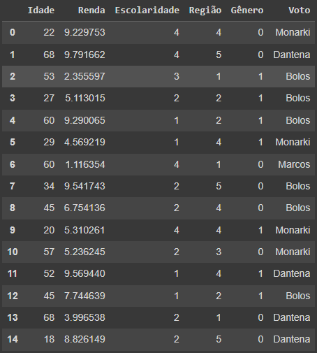
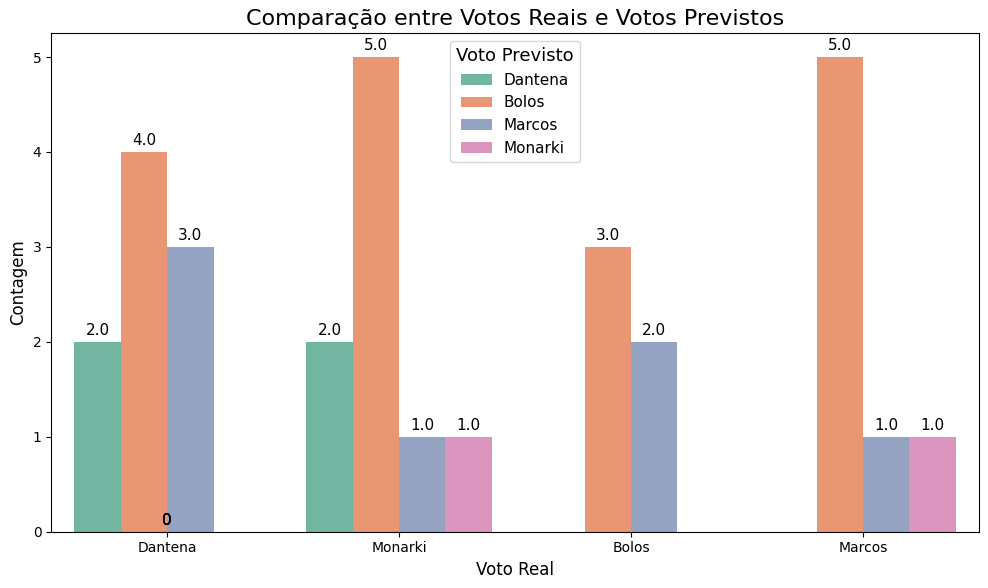
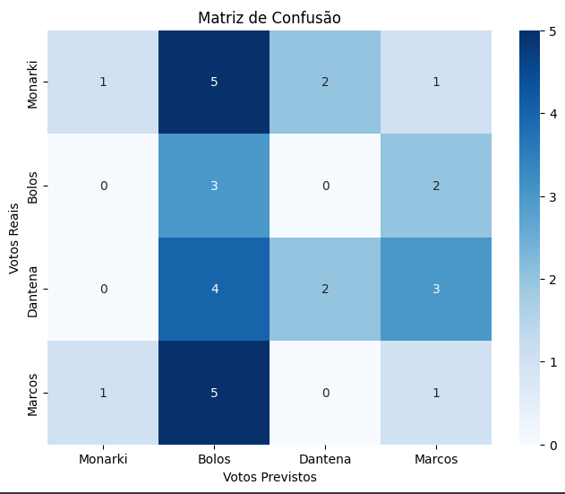

# Eleições SP 2024 (fictício): Regressão Logística Multinomial com dados inventados

Trabalho de IA da faculdade sobre intenção de voto para prefeito de São Paulo, agora também como **app de dados ao vivo** (dashboard, avaliação completa e simulador no navegador).

**Ao vivo:** https://g2martins.github.io/EleicoesSP-2024-IA/ · **No portfólio:** https://g2portfolio.grovicdata.com/projetos/eleicoes-sp-2024-ia

> **Modelo educacional treinado com dados fictícios; não é previsão eleitoral.** Os 100 eleitores, os votos e os quatro candidatos (Monarki, Bolos, Dantena e Marcos) são inventados e gerados com `np.random`. Nenhuma linha vem de pesquisa, do TSE ou de pessoas reais, e nenhuma saída do modelo diz algo sobre candidatos reais.

## Premissa do trabalho (enunciado)

Em 2024, um importante jornal de São Paulo pede uma previsão rápida de voto para prefeito. Com idade, renda, escolaridade, região e gênero de cada eleitor, o modelo deve estimar em qual de quatro candidatos fictícios ele votaria. Os nomes e perfis são personagens do enunciado; o modelo só vê números sorteados.

## Como funciona

1. **Dados**: seis sorteios independentes por eleitor (`main.py`): idade 18 a 69, renda de R$ 1 mil a R$ 10 mil, escolaridade (1 a 4), região (1 a 5), gênero (0/1) e o voto entre os quatro nomes.
2. **Treino**: `LogisticRegression(multi_class='multinomial', solver='lbfgs', max_iter=1000)`, split 70/30 com `random_state=42`.
3. **Avaliação**: acurácia, relatório de classificação, matriz de confusão e coeficientes por candidato.
4. **No navegador**: `export_model.py` refaz exatamente o `main.py` com uma única mudança, `np.random.seed(42)`, e grava coeficientes, métricas, curvas e a análise exploratória em JSON. O site calcula o softmax em TypeScript e o build falha se alguma das 20 probabilidades de controle diferir do `predict_proba` do scikit-learn em mais de 0,000001.



## Resultados (semente 42)

| Métrica (teste, 30 eleitores) | Valor |
|---|---|
| Acurácia | 16,7% |
| Acaso (1 em 4) | 25,0% |
| Baseline: classe mais comum | 30,0% |
| F1 macro | 0,16 |
| AUC macro um-contra-todos | 0,47 |

Como o voto é sorteado sem olhar as outras colunas, **não existe sinal para aprender**. Rodando o código original com 500 sementes diferentes, a acurácia de teste tem média de 24,4% e 90% dos sorteios caem entre 10,0% e 36,7%. O `main.py` não fixa semente, então cada execução dá um número diferente: a versão anterior deste README citava 30%; aqui, com semente 42, deu 16,7%. Os dois são ruído.

Coeficientes por candidato (semente 42, rótulos na ordem real de `modelo.classes_`):

| Variável | Bolos | Dantena | Marcos | Monarki |
|---|---|---|---|---|
| Idade | -0,0300 | -0,0498 | +0,0447 | +0,0351 |
| Renda | +0,3213 | +0,0453 | -0,1363 | -0,2303 |
| Escolaridade | +0,0587 | -0,0519 | +0,0423 | -0,0491 |
| Região | +0,0709 | -0,1680 | +0,1894 | -0,0923 |
| Gênero | +0,1517 | -0,0917 | +0,1421 | -0,2022 |
| Intercepto | -1,423 | +2,540 | -1,838 | +0,721 |

**Correção em relação à versão anterior:** `astype('category').cat.codes` numera os candidatos em ordem alfabética (Bolos=0, Dantena=1, Marcos=2, Monarki=3), mas o `main.py` imprimia os coeficientes com as linhas rotuladas como Monarki, Bolos, Dantena, Marcos, e a tabela antiga deste README herdou esse erro.

Limitações: dados fictícios e sem sinal, amostra minúscula (70 para treino, 30 para teste), códigos de região e escolaridade tratados como números contínuos, variáveis sem padronização e probabilidades confiantes demais.

### Gráficos do trabalho original




## Rodar o Python

```bash
pip install -r requirements.txt
python main.py                 # original: dados novos a cada execução
python -I export_model.py      # semente 42; regenera site/src/app/data/*.json e site/public/data/*
```

## Rodar o site

```bash
cd site
npm install
npm start            # http://localhost:4442/EleicoesSP-2024-IA/
npm run build:pages  # build + checagem + publica em ../docs/
npm run og           # imagem social e ícones (Playwright em Python)
```

`npm run check` (parte do `build:pages`) valida SEO, o aviso de dados fictícios, seções pré-renderizadas, downloads marcados como fictícios, ausência de travessão longo e a paridade TypeScript × scikit-learn.

## Deploy

GitHub Pages servindo `main:/docs` com base `/EleicoesSP-2024-IA/`. O `build:pages` gera `docs/` com `.nojekyll` e `404.html`.

## Contexto real

O resultado oficial do 2º turno de 2024 em São Paulo (TSE) aparece na página só como contexto, separado e sem relação com o modelo: Ricardo Nunes (MDB) 59,35% dos votos válidos, Guilherme Boulos (PSOL) 40,65%.

## 🏅 Créditos

- **Caio Silveira Guimarães** 🧠✨
- **Gustavo Martins Gripaldi** 🎮💡
- **Giovanna Monteiro Bispo** 🔍🎯
- **Mariana Monteiro Bispo** 💻🔥
- **Mayron Malaquias Oliveira** ⚡🎨

App de dados por [Gustavo Martins Gripaldi](https://g2portfolio.grovicdata.com).
